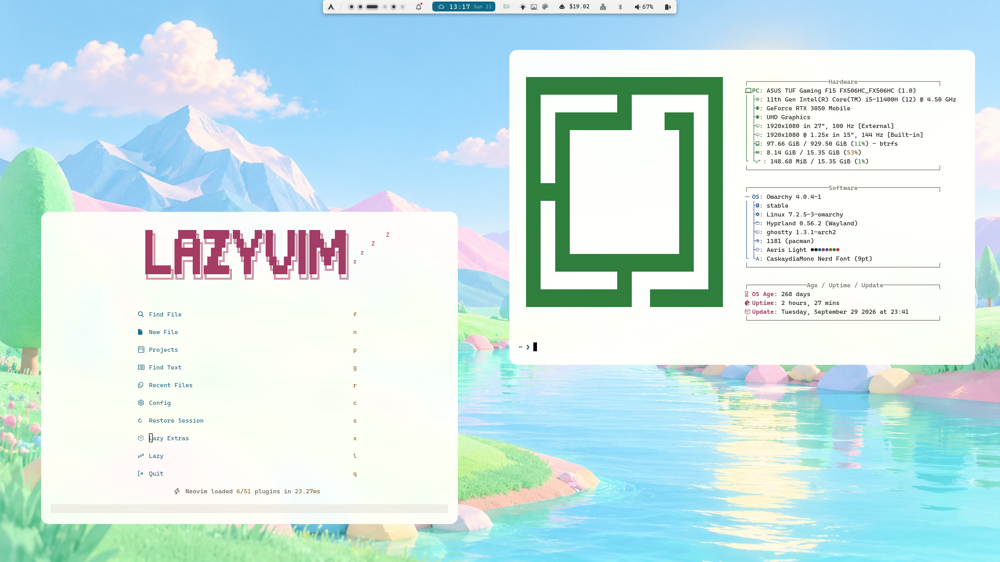

# aeris-light-theme

Light variant of the Aeris theme for [Omarchy](https://omarchy.org/): the
pink and cyan accents of
[aeris-dark-theme](https://github.com/woofasa/aeris-dark-theme), darkened
for readable text on a warm off-white background.



## Installation

```sh
omarchy theme install https://github.com/woofasa/aeris-light-theme.git
```

The theme is applied immediately. When installing from a git repository,
Omarchy skips every `*.lua` file, so two of them have to be installed by hand
(see below).

Omarchy detects the light mode from `mode = "light"` in `colors.toml`.

## Manual installation of Lua files

The files stay in the cloned theme directory, `~/.config/omarchy/themes/aeris-light/`.
Copy them into place:

```sh
T=~/.config/omarchy/themes/aeris-light

# Neovim (LazyVim): aeris-light-nvim plugin and colorscheme.
# For a repository install a plain copy is needed, not a symlink.
cp "$T/neovim.lua" ~/.config/nvim/lua/plugins/theme.lua

# Hyprland: gaps, rounding, blur and border colors.
# Overwrites an existing ~/.config/hypr/looknfeel.lua, so back it up first.
cp "$T/looknfeel.lua" ~/.config/hypr/looknfeel.lua
hyprctl reload
```

Requires LazyVim and network access to GitHub for the `woofasa/aeris-light.nvim`
plugin.

## Contents

- `colors.toml` - theme palette (`mode = "light"`)
- `shell.toml` - Omarchy bar and menu styling
- `icons.theme` - icon theme (`Yaru-sage`)
- `neovim.lua` - Neovim plugin spec (manual install, see above)
- `looknfeel.lua` - Hyprland look and feel (manual install, see above)
- `backgrounds/` - wallpapers, cycle with `omarchy theme bg next`
